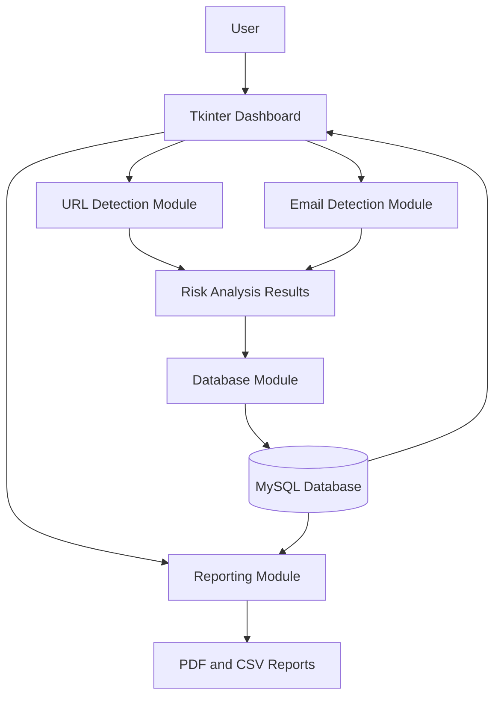

# PhishGuard – System Architecture

## 1. Introduction

PhishGuard uses a modular desktop application architecture. Its components work together to analyze URLs and email content, store scan results, display statistics, and generate reports.

The system is developed using Python, Tkinter, and MySQL.

## 2. High-Level Architecture

The application consists of five major components:

1. User Interface
2. Detection Engine
3. Database Management
4. Reporting Module
5. Testing Module

## 3. Architecture Diagram

## 4. Component Description

### 4.1 User Interface – Frontend

**Module:** `frontend/dashboard.py`

The frontend is developed using Tkinter.

Its responsibilities include:

- Displaying the application dashboard.
- Accepting URLs and email content from users.
- Initiating URL and email analysis.
- Displaying analysis results and risk levels.
- Showing scan history and dashboard statistics.
- Providing report generation and history management options.

### 4.2 Detection Engine – Backend

The detection engine contains the application's analysis logic.

**URL Detection**

Module: `backend/url_detection.py`

- Receives submitted URLs.
- Examines URL characteristics using predefined rules.
- Identifies suspicious indicators.
- Produces a risk assessment.

**Email Detection**

Module: `backend/email_detection.py`

- Receives email content.
- Examines suspicious phrases and other indicators.
- Evaluates potential phishing characteristics.
- Produces a risk assessment.

### 4.3 Database Management

**Module:** `backend/database.py`

PhishGuard uses MySQL for persistent data storage.

Its responsibilities include:

- Establishing database connections.
- Saving URL scan results.
- Saving email scan results.
- Retrieving scan history.
- Providing dashboard statistics.
- Deleting individual records or clearing scan history.

### 4.4 Reporting Module

**Module:** `backend/reports.py`

The reporting module supports the generation of:

- PDF reports.
- CSV reports.

These reports help users review and maintain records of security analysis results.

### 4.5 Testing Module

**Directory:** `tests/`

Testing scripts are provided for checking:

- URL detection functionality.
- Email detection functionality.
- Database operations.

## 5. Application Workflow

The general application workflow is:

1. The user launches PhishGuard through `main.py`.
2. The Tkinter dashboard is displayed.
3. The user selects URL analysis or email analysis.
4. The corresponding backend detection module analyzes the input.
5. The application displays the analysis result and risk classification.
6. Scan information is stored in the MySQL database.
7. Dashboard statistics and scan history can be retrieved.
8. The user can generate PDF or CSV reports.

## 6. Database Architecture

PhishGuard uses MySQL to maintain scan records.

The database layer manages operations such as:

- Database connection.
- Record insertion.
- Record retrieval.
- Dashboard statistics.
- Record deletion.

Database credentials are configured locally through environment variables rather than being included directly in public source code.

## 7. Technology Integration

| Component | Technology |
|---|---|
| Desktop Interface | Tkinter |
| Application Logic | Python |
| URL Analysis | Python |
| Email Analysis | Python |
| Data Storage | MySQL |
| Database Connectivity | mysql-connector-python |
| Environment Configuration | python-dotenv |
| PDF Generation | ReportLab |
| CSV Generation | Python CSV functionality |

## 8. Security Considerations

- Database credentials should be kept outside public source code.
- The `.env` file should not be committed to GitHub.
- Detection results should be treated as risk indicators, not guarantees.
- Users should avoid opening suspicious links or sharing sensitive information.

## 9. Conclusion

The architecture of PhishGuard separates the user interface, detection logic, database operations, and report generation into dedicated modules.

This modular design makes the application easier to maintain, understand, test, and extend with additional cybersecurity capabilities.